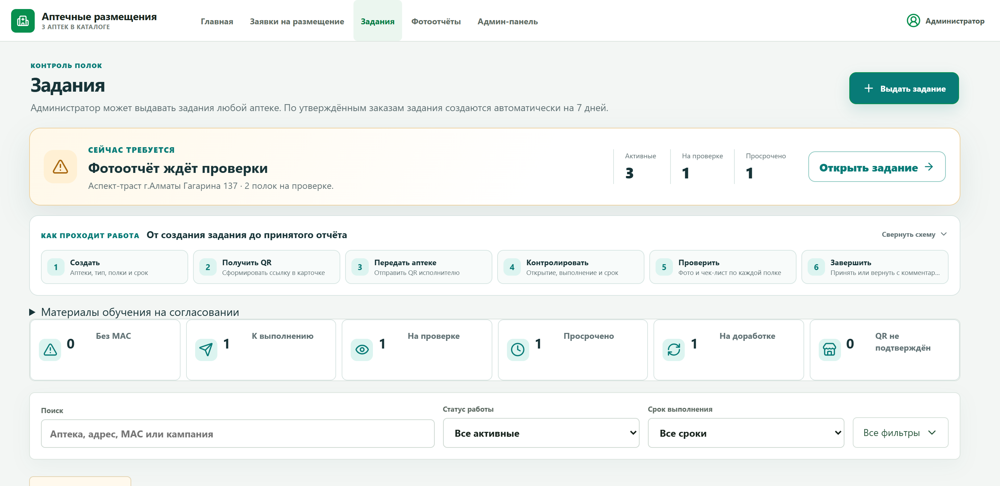
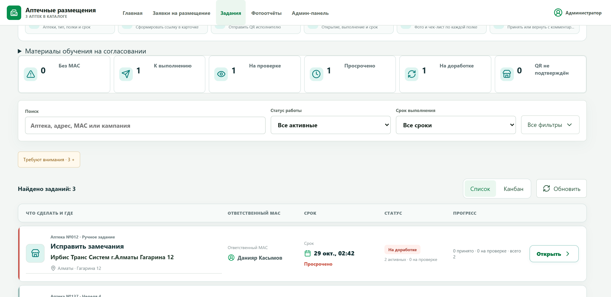
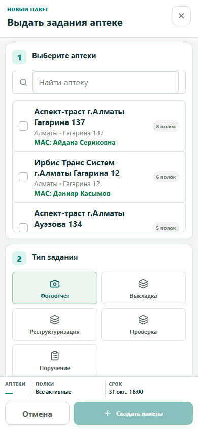

# Редизайн кабинета мерчендайзинга — 2026-10-29

## Результат

Обновлён интерфейс администратора и исполнения без изменения текущего бизнес-флоу. Боевой frontend опубликован на сервере `10.10.1.80` как релиз `merch-epharm-ui-20261029-246c9553b557`.

Что изменено:

- очередь заданий стала заметно легче для сканирования: основное действие и аптека выделены, срок и статус читаются быстрее, вторичная информация приглушена;
- действие «Открыть» больше не сжимается: для него закреплена колонка 116 px, текст и стрелка имеют стабильный интервал, а на телефоне действие занимает всю ширину карточки;
- строки очереди разделены на самостоятельные карточки с отдельной адаптивной раскладкой для планшета;
- шапка таблицы закреплена при длинной прокрутке, прогресс больше не обрезается;
- сильный красный акцент оставлен только для просрочки, отсутствующего МАС и возврата на доработку;
- схема процесса сворачивается, а на телефоне фильтры занимают меньше места;
- вместо скачка контента при загрузке показан skeleton;
- форма создания сохранила прежние пять шагов, но получила постоянную нижнюю сводку по аптекам, полкам и сроку;
- QR-страница и кабинет исполнителя получили единые подсказки по шагам выполнения;
- исправлена геометрия нижней панели заказа производителя.

## Ограничения изменения

- backend, PostgreSQL, миграции и API не изменялись;
- порядок создания, выдачи QR, выполнения, проверки и принятия задания не изменялся;
- сервис `pharmacy-crm-demo.service` не перезапускался;
- остальные Docker-процессы сервера не трогались.

## Проверки

- Vite production build: 1 869 модулей, успешно;
- 47 Node-тестов планирования и оформления: успешно;
- 7 тестов task dispatch workflow: успешно;
- 2 теста прокрутки страницы заданий: успешно;
- 7 тестов minimal redesign: успешно;
- 8 тестов P0/P1 operational improvements: успешно;
- визуальная проверка 1440 × 1000, 1280 × 900 и 390 × 844: горизонтального переполнения нет, ширина действия 116 / 116 / 336 px соответственно;
- production smoke: 27 карточек загружены, asset `assets/index-Wxue5Own.js`, очередь и действие открываются на реальных данных;
- после выкладки PID backend и ID постоянных Docker-контейнеров не изменились.

## Артефакты

- применяемый diff: [`ops/merch-portal-patches/merch-epharm-ui-redesign-20261029.patch`](../../ops/merch-portal-patches/merch-epharm-ui-redesign-20261029.patch);
- SHA-256 production `dist/index.html`: `5e66ed7f55aeb92cd39331bb8d04bbda0711f764057249ae8830d39909be96aa`;
- rollback на сервере: `/opt/pharmacy-crm-demo/frontend-rollbacks/dist-before-merch-epharm-ui-20261029-246c9553b557`.

### Администратор: центр управления

### Администратор: очередь

### Создание задания на телефоне

